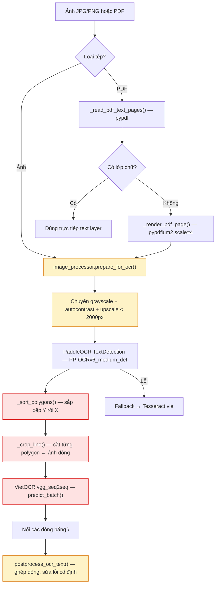

# Phân tích Pipeline OCR tiếng Việt — Phát Thanh AI

## Tổng quan luồng xử lý hiện tại



---

## Phát hiện vấn đề — 7 điểm yếu ảnh hưởng đến độ chính xác

### 🔴 VẤN ĐỀ 1: Tiền xử lý ảnh chuyển thành Grayscale phá hỏng input cho PaddleOCR

**File:** [`image_processor.py`](file:///d:/Code/TextToSpeed/app/services/image_processor.py#L19)

```python
corrected = ImageOps.exif_transpose(image).convert("L")   # ← Grayscale!
corrected = ImageOps.autocontrast(corrected, cutoff=1)
corrected = ImageEnhance.Contrast(corrected).enhance(1.35)
```

**Vấn đề:** `prepare_for_ocr()` chuyển ảnh sang **grayscale 1 kênh (mode "L")**, nhưng PaddleOCR TextDetection và VietOCR đều được thiết kế hoạt động tốt nhất trên ảnh **RGB 3 kênh**. Khi `cv2.imread(str(source), cv2.IMREAD_COLOR)` đọc ảnh grayscale, nó sẽ tái tạo 3 kênh giả (BGR channels identical), nhưng model detection đã mất thông tin màu sắc giúp phân biệt chữ với nền, viền bảng, và đặc biệt là **watermark/con dấu đỏ** phổ biến trên văn bản hành chính Việt Nam.

Thêm nữa, `autocontrast` với cutoff=1 kết hợp `enhance(1.35)` có thể **tăng quá mức nhiễu nền** trên ảnh chụp từ điện thoại, khiến PaddleOCR phát hiện sai vùng chữ (false positive polygons).

**Mức độ ảnh hưởng:** Cao — Ảnh hưởng đến MỌI ảnh đi qua pipeline.

---

### 🔴 VẤN ĐỀ 2: Cắt crop dòng chữ cho VietOCR không padding, không chuẩn hóa kích thước

**File:** [`ai_ocr_service.py`](file:///d:/Code/TextToSpeed/app/services/ai_ocr_service.py#L76-L107)

```python
def _crop_line(image, polygon):
    # ...perspective transform...
    cropped = cv2.warpPerspective(image, transform, (width, height), borderValue=(255, 255, 255))
    return Image.fromarray(cv2.cvtColor(cropped, cv2.COLOR_BGR2RGB))
```

**Các vấn đề cụ thể:**

1. **Thiếu padding xung quanh dòng chữ:** VietOCR cần khoảng trống (margin) xung quanh dòng chữ để nhận dạng chính xác dấu thanh tiếng Việt (dấu sắc, huyền, hỏi, ngã, nặng) và dấu phụ (ô, ơ, ê, ư, â). Khi `warpPerspective` cắt sát viền polygon, các dấu phía trên/dưới chữ cái bị **cắt mất** (đặc biệt ả, ẻ, ỷ, ổ, ử — những ký tự có dấu hỏi/ngã nằm cao nhất).

2. **Không chuẩn hóa chiều cao:** VietOCR `vgg_seq2seq` được huấn luyện trên ảnh dòng có chiều cao cố định (mặc định 32px). Các dòng cắt ra có chiều cao bất kỳ, và VietOCR tự resize — nhưng nếu dòng quá cao (ảnh chụp cận cảnh) hoặc quá thấp (chữ nhỏ), tỷ lệ khung hình bị méo.

3. **Không nhóm batch theo chiều rộng tương đồng:** `predict_batch(crops)` đưa tất cả crops cùng một lúc bất kể kích thước. Khi VietOCR pad images trong batch lên cùng width, crop ngắn bị pad rất nhiều → attention mechanism bị nhiễu.

**Mức độ ảnh hưởng:** Rất cao — Đây là nguyên nhân chính gây mất dấu tiếng Việt.

---

### 🟡 VẤN ĐỀ 3: Sắp xếp thứ tự đọc polygons quá đơn giản

**File:** [`ai_ocr_service.py`](file:///d:/Code/TextToSpeed/app/services/ai_ocr_service.py#L64-L73)

```python
def _sort_polygons(polygons):
    return sorted(
        polygons,
        key=lambda polygon: (
            sum(float(point[1]) for point in polygon) / max(1, len(polygon)),  # Y trung bình
            sum(float(point[0]) for point in polygon) / max(1, len(polygon)),  # X trung bình
        ),
    )
```

**Vấn đề:** Sắp xếp thuần theo tọa độ Y rồi X (sort toàn cục) sẽ **lẫn lộn thứ tự đọc** với văn bản hành chính có bố cục phức tạp:

- Văn bản 2 cột (ví dụ: phần "Số:" bên trái và "...ngày... tháng... năm..." bên phải ở đầu công văn)
- Bảng biểu với nhiều cột dữ liệu
- Tiêu đề căn giữa có Y gần bằng dòng phía dưới

Nên cần sắp xếp **theo cụm dòng (row clustering)** — nhóm các polygon cùng hàng ngang (Y gần nhau) rồi sắp trái-phải trong mỗi hàng.

**Mức độ ảnh hưởng:** Trung bình — Gây đảo lộn thứ tự văn bản khi bố cục phức tạp.

---

### 🟡 VẤN ĐỀ 4: Không lọc polygon theo confidence score (dt_scores)

**File:** [`ai_ocr_service.py`](file:///d:/Code/TextToSpeed/app/services/ai_ocr_service.py#L119-L127)

```python
results = self._get_detector().predict(str(source))
payload = results[0].json["res"] if results else {}
polygons = payload.get("dt_polys") or []
```

**Vấn đề:** PaddleOCR trả về `dt_scores` (confidence score) cho mỗi polygon, nhưng code hiện tại **bỏ qua hoàn toàn** trường này. Các polygon có confidence thấp (< 0.5) thường là:
- Nhiễu nền, vết bẩn, đường kẻ bảng
- Viền con dấu đỏ
- Logo, hoa văn trang trí

Những polygon này khi cắt ra và đưa vào VietOCR sẽ tạo ra **chữ rác** lẫn vào nội dung thật.

**Mức độ ảnh hưởng:** Trung bình — Gây thêm văn bản nhiễu cán bộ phải xóa thủ công.

---

### 🟡 VẤN ĐỀ 5: Bộ sửa lỗi OCR phổ biến quá cứng nhắc (hardcoded + thiếu nhiều pattern)

**File:** [`text_processor.py`](file:///d:/Code/TextToSpeed/app/services/text_processor.py#L48-L72)

**Vấn đề:** `_COMMON_OCR_PHRASE_FIXES` chỉ chứa ~20 pattern cố định, chủ yếu liên quan đến **một tài liệu cụ thể** (Quyết định chuyển giao Trường Cao đẳng Nông Lâm). Các lỗi OCR tiếng Việt phổ biến hơn chưa được bao phủ:

| Lỗi OCR thường gặp | Đúng | Nguyên nhân |
|---|---|---|
| `ũ` → `ủ` hoặc ngược lại | Nhầm dấu ngã/hỏi | Dấu ngã ~ và hỏi ˀ rất giống nhau ở cỡ nhỏ |
| `ơ` → `o`, `ư` → `u` | Mất dấu mũ/móc | VietOCR crop sát hoặc font nhỏ |
| `đ` → `d` | Mất nét gạch ngang | Nét gạch mờ trong ảnh chụp |
| Dính/tách từ sai | "Ủ yban" → "Ủy ban" | Kerning bất thường trong ảnh scan |

Tuy nhiên, việc mở rộng hardcoded patterns không phải hướng tốt — nó quá giòn (brittle) và chỉ sửa được những gì đã biết trước.

**Mức độ ảnh hưởng:** Trung bình — Bộ sửa lỗi hiện tại hữu ích nhưng bao phủ rất hẹp.

---

### 🟢 VẤN ĐỀ 6: Thiếu cơ chế beamsearch cho VietOCR

**File:** [`ai_ocr_service.py`](file:///d:/Code/TextToSpeed/app/services/ai_ocr_service.py#L48-L57)

```python
engine_config = Cfg.load_config_from_file(str(config.VIETOCR_CONFIG_PATH))
engine_config["device"] = "cpu"
# Không thiết lập beamsearch
```

**Vấn đề:** VietOCR mặc định dùng **greedy decoding** (chọn ký tự xác suất cao nhất tại mỗi bước). Bật **beam search** (beam_width=3–5) cho phép VietOCR xem xét nhiều giả thuyết đồng thời, giúp cải thiện đáng kể các trường hợp dấu thanh mơ hồ (ví dụ: `ũ` vs `ủ`, `ã` vs `ả`). Trên CPU, beam_width=3 chỉ chậm hơn ~20-30% nhưng cải thiện accuracy đáng kể cho dấu tiếng Việt.

**Mức độ ảnh hưởng:** Thấp-Trung bình — Cải thiện nhẹ nhưng đáng kể cho dấu thanh.

---

### 🟢 VẤN ĐỀ 7: Fallback Tesseract cũng bị ảnh hưởng bởi grayscale + autocontrast

**File:** [`ocr_service.py`](file:///d:/Code/TextToSpeed/app/services/ocr_service.py#L168-L189)

Khi AI OCR lỗi, Tesseract nhận ảnh đã qua cùng pipeline `prepare_for_ocr()` đã chuyển grayscale. Tesseract thực ra hoạt động tốt hơn với grayscale, nhưng `autocontrast(cutoff=1)` + `enhance(1.35)` quá mạnh cho nhiều loại ảnh chụp từ điện thoại — có thể gây ra "bleeding" (chữ dính nhau) hoặc mất nét mỏng.

**Mức độ ảnh hưởng:** Thấp — Chỉ ảnh hưởng khi fallback.

---

## Kế hoạch khắc phục — Theo thứ tự ưu tiên

> [!IMPORTANT]
> Hai vấn đề quan trọng nhất cần sửa ngay là **VĐ1** (tiền xử lý ảnh) và **VĐ2** (crop + padding cho VietOCR) — chúng ảnh hưởng trực tiếp đến khả năng nhận dạng dấu tiếng Việt trong mọi ảnh.

### Sửa đổi 1: `image_processor.py` — Tách luồng xử lý AI OCR vs Tesseract

- **Với PaddleOCR + VietOCR (AI):** Giữ ảnh **RGB**, chỉ sửa EXIF orientation, upscale nhẹ (nếu cần), **không** chuyển grayscale, **không** tăng contrast quá mức.
- **Với Tesseract (fallback):** Giữ nguyên pipeline grayscale + autocontrast hiện tại (vì Tesseract xử lý grayscale tốt hơn).

### Sửa đổi 2: `ai_ocr_service.py` — Padding + chuẩn hóa crop + lọc confidence + row clustering

- Thêm padding 4-8px xung quanh mỗi crop (nền trắng) để bảo toàn dấu tiếng Việt
- Lọc bỏ polygon có `dt_scores < 0.5`
- Chuẩn hóa chiều cao crop về 32px (giữ nguyên tỷ lệ khung hình)
- Nhóm polygon cùng hàng ngang trước khi sắp xếp trái-phải (row clustering)
- Chia batch theo nhóm chiều rộng tương đồng cho `predict_batch`

### Sửa đổi 3: `ai_ocr_service.py` — Bật beam search cho VietOCR

- Thiết lập `beamsearch = True` trong config engine (hoặc `predictor.beamsearch = True`)

### Sửa đổi 4: `text_processor.py` — Mở rộng bộ sửa lỗi OCR tiếng Việt

- Thêm các pattern phổ biến hơn cho lỗi dấu thanh và dấu phụ
- Nhưng giữ nguyên nguyên tắc "chỉ sửa khi ngữ cảnh rõ ràng"
